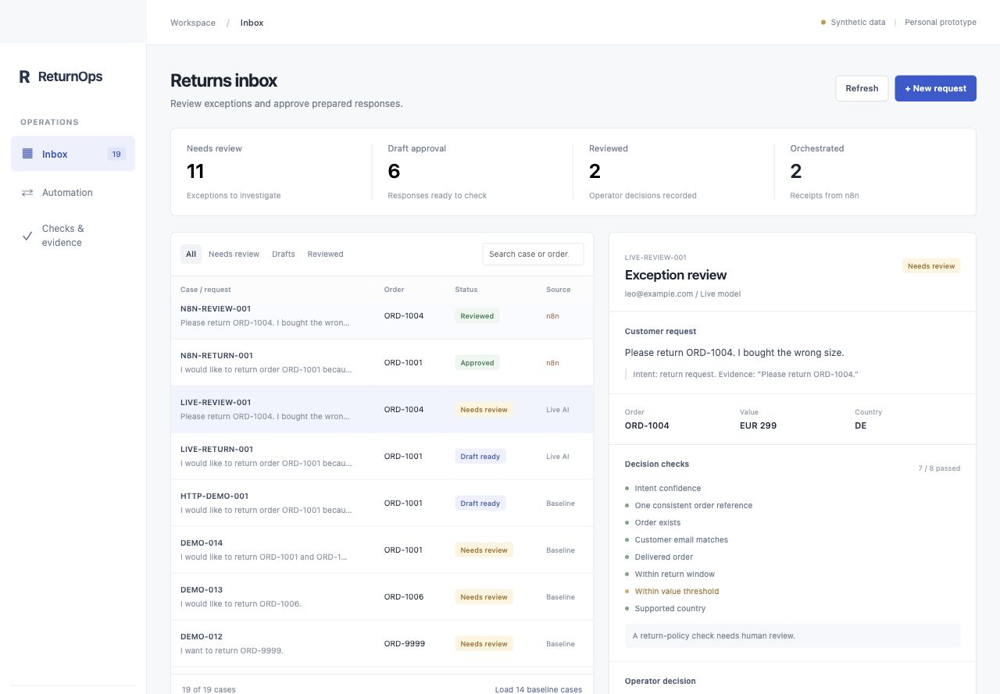
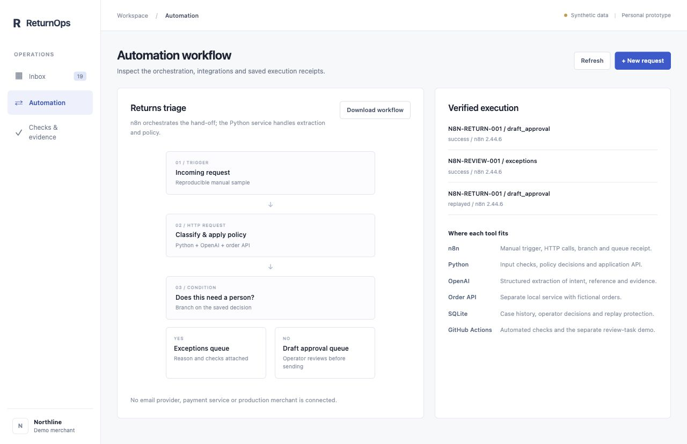

# ReturnOps

An operations desk for reviewing return requests, with a working n8n workflow and AI-assisted intent extraction. Personal project by Roman Petrov, built with AI coding assistance.

A customer asks to return an order. The system extracts what they need, fetches the order from a separate HTTP service, checks the merchant's rules, and routes the case to draft approval or exception review. An operator can edit the draft, record a decision and inspect its history.

All orders, customers and policies are fictional. This is an independent prototype, not a REVER integration.



## What runs

| Component | Responsibility |
| --- | --- |
| **n8n** | Manual scenario trigger, HTTP calls, conditional branch and recorded queue hand-off |
| **Python service** | Input validation, order lookup, explicit policy checks and API endpoints |
| **OpenAI Responses API** | Structured extraction of intent, order reference and supporting text |
| **Sandbox order API** | Separate local HTTP service serving fictional order records |
| **SQLite** | Saved outcomes, operator decisions, revision checks and event deduplication |
| **Browser desk** | Searchable inbox, editable drafts, exception notes, activity history and evidence |
| **GitHub Actions / Issues** | Automated checks and a separate, verified review-task integration |

The model interprets the message. Code applies the policy. The response is a policy-based template that an operator can edit. No customer message, shipping label or refund is sent.

## Run the desk

Python 3.9+; the Python application uses only the standard library.

```sh
python3 launch_demo.py
```

Open http://127.0.0.1:8765. Click **Load 14 baseline cases** to fill the inbox without an API key. Select a case to inspect its order, checks and proposed next step. Approve a draft or record what should happen to an exception; both actions persist after reload.

The launcher starts both the desk and the separate order HTTP service. `python3 app.py` also works, using local fixtures unless `ORDER_API_URL` is configured. Keep these development services on loopback.

## Run n8n

Two importable workflows are included in [automation/n8n](automation/n8n):

- **ReturnOpsLive001**: a EUR 79 order reaches draft approval.
- **ReturnOpsLive002**: a EUR 299 order exceeds the fictional EUR 150 threshold and reaches exception review.

Both use real model extraction through the Python service. They were imported into local n8n 2.44.6 and executed successfully. Repeating the first workflow returned the saved result and queue receipt, without another model call. See the [execution evidence](artifacts/n8n-verification.json) and [setup instructions](automation/n8n/README.md).



The triggers are reproducible manual samples, not a connected live helpdesk. n8n calls the Python endpoint; it does not directly hold the model credential or connect to a production shop. Zapier, Make and GuruSup are not used in this project.

## AI and baseline modes

| Mode | Behaviour |
| --- | --- |
| Offline baseline | Keyword rules; no model calls or provider account required |
| Live AI | OpenAI Responses API with Structured Outputs; one call per new live ticket, except pre-model safety stops |

Live mode loads `OPENAI_API_KEY` from the ignored local `.env.local` file or server environment. Existing environment values take precedence. `.env.example` is a template, not a credential. The verified model is `gpt-6-luna`, reasoning disabled, output capped at 400 tokens. See the [Structured Outputs documentation](https://developers.openai.com/api/docs/guides/structured-outputs).

Only message text is sent to the model. References and supporting excerpts are checked against that message. A failed request or invalid extraction goes to human review. Model confidence is a routing heuristic, not a calibrated probability. Live calls incur provider usage fees; viewing the desk and running the baseline do not.

## Decisions survive retries

- Replaying the same ticket ID and content returns its stored outcome. Changed content under the same ID is rejected. Use a fresh ID after changing code or policy.
- Queue events have stable IDs. Repeating the same event reuses it; conflicting content is rejected.
- Operator decisions have revision numbers. An old browser view cannot silently overwrite a newer decision.
- Exceptions cannot be approved as automatic drafts. Reviewing an exception requires a note with its next step.
- The reference date is fixed at 22 October 2026 so the fictional date checks are reproducible.

## Evidence

| Check | Observed result |
| --- | --- |
| Automated tests | **39 passed**, covering policy, HTTP integrations, provider handling, configuration, review revisions and replay conflicts |
| Original baseline cases | **14/14** expected routes |
| Broader baseline set | **34/40** expected routes; inspect the six mismatches |
| Live AI on the same authored set | **40/40** expected routes; **38** validated provider extractions and **2** pre-model stops |
| Local n8n | Both routes executed; repeated request and dispatch replayed without new processing |
| Operator desk | Draft editing/approval and exception review saved and retained after a browser reload |
| GitHub Issues API | [Issue #1 created](https://github.com/rp-ceo/returns-workflow-lab/issues/1), then [reused on rerun](https://github.com/rp-ceo/returns-workflow-lab/actions/runs/39857793546) in offline mode |

```sh
python3 -m unittest discover -s tests -v
python3 evaluate.py --mode demo
```

[Live verification and limitations](docs/live-verification.md) separate model results, n8n execution and the GitHub write. The 40 cases are authored synthetic examples, including the original fixtures. They are not held-out customer data, production accuracy, time savings or an autonomous-resolution rate.

## Separate GitHub review-task demo

Open **Actions → Run an operations scenario → Run workflow**, choose `DEMO-005` and mode `demo`. The manually triggered workflow uses the sandbox order service and creates or reuses a real GitHub issue on fictional data. It saves a JSON artifact.

GitHub supplies a short-lived token with `contents: read` and `issues: write`. Only supplied scenario IDs and `example.com` tickets are allowed. For cloud mode `live`, the owner would need to configure an `OPENAI_API_KEY` repository secret; that combined cloud path has not been verified. The local model key is not published to GitHub.

Issue deduplication uses a ticket marker and payload hash, with demo runs serialized. It is a bounded demonstration, not a transactional guarantee across independent workers or unlimited issue history. Unknown POST outcomes are not blindly retried.

## Read or demonstrate

- [Five-minute demo](docs/demo-guide.md)
- [Business case and pilot measurements](docs/business-case.md)
- [Design choices and tool trade-offs](docs/architecture-decisions.md)
- [Importable n8n workflows](automation/n8n)

Key files: `workflow.py` (extraction/policy), `operations.py` (operator events), `shop_api.py` (order service), `app.py` (desk API), `web/` (interface), `evaluate.py` (routing comparison), and `github_queue.py` (external review tasks).

This prototype has no production merchant connection, authenticated shopper identity, operator login, automatic refunds, calibrated confidence score or comprehensive prompt-injection protection. A production rollout needs real policies, authenticated access, operational monitoring and a measured pilot.
