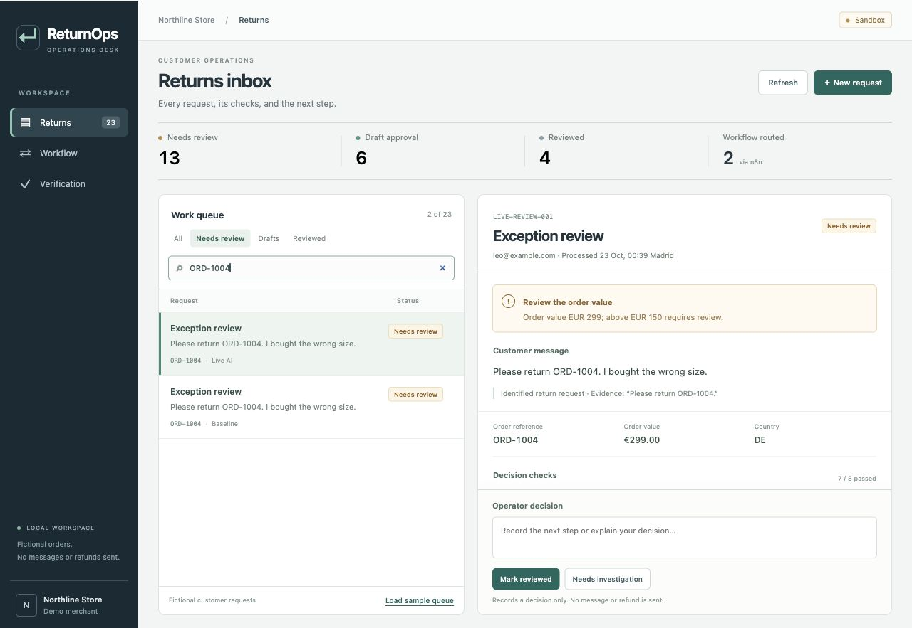

# ReturnOps

ReturnOps is a local workspace for reviewing return requests and delivery questions. I built it to keep the customer message, order details, policy checks and operator decision together.

It uses fictional orders and store rules. Nothing is sent to customers, and no shipping labels or refunds are issued.

[Test results and integration records](docs/verification.md)



## What it does

1. Receives a request from the browser desk or an n8n workflow.
2. Extracts the intent and order reference using keyword rules or the OpenAI API.
3. Looks up the order through a separate local HTTP service and checks the sender, delivery date, return window, order value and country.
4. Prepares a response draft or flags the case for review. An operator can edit the draft, add a note and record a decision.

Python applies the store rules and uses fixed response templates. SQLite saves cases and review history. n8n makes the HTTP calls and records which queue receives the case. The interface uses HTML, CSS and JavaScript.

## Run locally

Python 3.9 or later. The Python app has no third-party dependencies.

```sh
python3 launch_demo.py
```

Open http://127.0.0.1:8765 and click **Load sample queue**. No API key is needed. The launcher starts the desk and the local order service. `python3 app.py` starts the desk alone, using order fixtures.

For model extraction, copy `.env.example` to `.env.local` and add an OpenAI API key. Existing environment variables take precedence. The default model is `gpt-6-luna`, with a 400-token output limit. Only message text goes to OpenAI. Model calls use API credit.

The two [n8n workflows](automation/n8n/README.md) demonstrate a standard return and a high-value exception. Their triggers are manual; no helpdesk is connected.

## Tests and reports

```sh
python3 -m unittest discover -s tests -v
python3 run_demo.py
python3 evaluate.py --mode demo
python3 evaluate.py --mode demo --suite challenge
python3 run_case.py --ticket DEMO-005 --mode demo
npm ci --ignore-scripts
npm test
```

Reports are saved in the ignored `runtime/reports/` directory. The Python scripts accept `--output PATH`. The evaluation reports routing, labelled intents, missed reviews and unnecessary escalations separately. The original 40 cases have route labels only; the 32 challenge cases add intent labels, negation and mixed requests. Both sets are authored development examples. Use `--cases PATH` for another labelled case file.

`python3 evaluate.py --mode live` runs the original 40 cases through the model and saves the report shown in the desk. This makes paid API calls. `--suite challenge` and `--suite all` save separate files. Results on these examples do not establish production accuracy.

Formatting: install `requirements-dev.txt`, then run `python3 -m black --check .` and `npm run format:check`. CI checks Python 3.9, 3.11 and 3.14, plus the frontend on Node 24.

## Behaviour and limits

- The same ticket ID and content return the saved result. Changed content needs a new ID. Different tickets process concurrently. A per-ticket lock prevents duplicate processing within one server process; separate processes may still make duplicate model calls.
- After an extraction or order-service failure, an operator can add a note and choose **Retry processing**. This creates a new numbered attempt using the saved message. Earlier results, notes and queue receipts remain in the history. Ordinary policy exceptions cannot be retried this way. Customer follow-up replies and conversation threads are not implemented.
- Review and retry actions check both the processing attempt and the review revision. A stale browser cannot overwrite a newer decision. Repeating a retry event returns that attempt without another model call. Approving a draft only records approval.
- Offline extraction uses English and Spanish phrase rules with limited negation handling. It still misses paraphrases; its confidence number is a heuristic. Damage and payment problems take priority over ordinary requests. An active return plus tracking request goes to review rather than answering only one part.
- The return policy uses a fixed date of 22 October 2026. Sender-email matching is a fixture check, not customer authentication. The override-phrase filter catches some suspicious messages; schema validation and policy checks also run independently.
- The app has no operator login or production shop connection. Keep it on loopback. A separate, manually triggered GitHub Actions scenario can create or reuse a fictional review issue with `issues: write` permission.

[MIT licence](LICENSE) · [n8n setup](automation/n8n/README.md)
